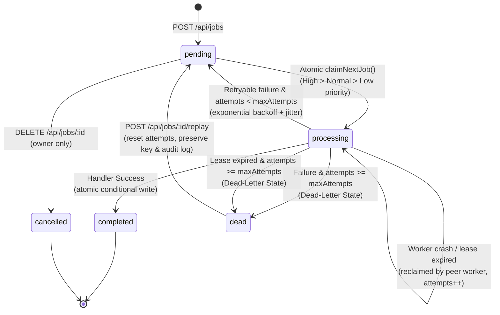
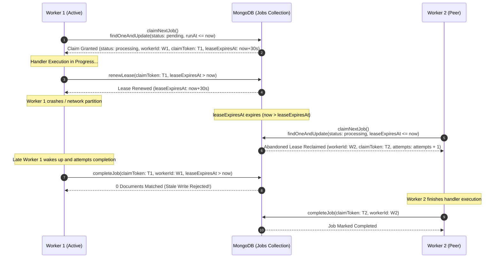

# Architecture

## Current foundation (Day 1)

This is a JavaScript monorepo with two separate applications:

- `client/`: React user interface served by Vite. In development, Vite proxies `/api` requests to the Express API.
- `server/`: Express API and Mongoose connection management.
- MongoDB: persistence layer, enabled by `MONGODB_URI`.

The Express API provides session, health, job, analytics, and worker-monitoring endpoints. Job records are stored in MongoDB through the Mongoose `Job` model. A separate Node.js worker process polls MongoDB, claims eligible jobs atomically, runs registered handlers, and records completion or failure. Retries, worker leases, heartbeats, expired-lease recovery, dead-letter handling, manual replay, tenant isolation, and dashboard analytics are implemented.

## Queue design direction

The queue engine is implemented in this codebase with MongoDB and Mongoose, not with BullMQ or another queue library. MongoDB atomic document updates claim work so that concurrent workers cannot successfully claim the same available job.

The planned reliability flow is:

1. Store each job's state, priority, scheduled time, attempt count, and idempotency key.
2. Atomically claim eligible jobs and assign worker ownership.
3. Add leases and recover work whose lease expires after a worker crash.
4. Retry failures with exponential backoff; move exhausted jobs to a dead-letter state.
5. Record attempts and allow an operator to replay a dead-lettered job.
6. Expose status/history to the React monitoring dashboard and notify it of persisted lifecycle changes.

The dashboard uses REST for authoritative reads and Socket.IO for lifecycle notifications. Operational analytics and worker liveness are backed by MongoDB.

### System Component Topology

```mermaid
flowchart TD
  subgraph ClientTier["Client Tier"]
    UI["React 19 Dashboard<br/>(Tailwind CSS + Vite)"]
  end

  subgraph APITier["Express API Server"]
    Router["REST API Router<br/>(Auth, Jobs, Analytics, Uploads)"]
    Bridge["Realtime Bridge<br/>(Socket.IO + Event Tailer)"]
  end

  subgraph DatabaseTier["Database Tier (MongoDB)"]
    JobsColl[("Jobs Collection<br/>• Atomic claims & leases<br/>• Compound idempotency index")]
    EventsColl[("Queue Events Collection<br/>• Capped 24h retention")]
    AssetsColl[("Job Assets Collection<br/>• Metadata only")]
  end

  subgraph WorkerTier["Background Worker Engine"]
    Worker["Worker Loop (Polling)"]
    Heartbeat["Heartbeat Manager<br/>(Lease renewal)"]
    Handlers["Handler Registry<br/>• send_email (Resend / Mock)<br/>• generate_pdf (PDFKit)<br/>• process_image (Sharp)"]
  end

  subgraph StorageTier["Private File Storage"]
    Storage[("server/storage/<br/>• users/:ownerId/uploads<br/>• users/:ownerId/outputs")]
  end

  UI -- "REST + Session Cookie + CSRF" --> Router
  UI <.. "Real-time updates" ..> Bridge
  Router -- "Enqueue pending jobs" --> JobsColl
  Bridge -- "Tail new events" --> EventsColl
  Worker -- "Atomic findOneAndUpdate() claim" --> JobsColl
  Heartbeat -- "Periodic lease extension" --> JobsColl
  Worker --> Handlers
  Handlers -- "PDF / Transformed images" --> Storage
  Handlers -- "Save asset metadata" --> AssetsColl
  Router -- "Stream authenticated artifacts" --> Storage
```

### Job Lifecycle State Machine



## Day 2 job persistence

The `Job` model stores job input, status, priority, attempt limits, scheduled time, optional error/idempotency metadata, and Mongoose timestamps. A partial unique index on `{ ownerId, idempotencyKey }` enforces per-tenant uniqueness only for provided idempotency keys on owned jobs. Status/creation and status/run-time indexes support listing and future scheduling queries.

Job API route tests inject an in-memory model, while schema tests use Mongoose validation without connecting to Atlas. This keeps automated tests isolated from persistent databases.

## Day 3 worker lifecycle

The Express API and worker are separate Node.js processes. The API writes pending jobs to MongoDB. Each worker connects independently, polls at `WORKER_POLL_INTERVAL_MS`, and uses `findOneAndUpdate()` to claim one due pending job. It checks priority buckets in `high`, `normal`, `low` order and sorts oldest first by `createdAt`, then `_id` for deterministic ties.

The atomic claim changes status to `processing` and records `workerId`, a fresh `claimToken`, `claimedAt`, and `leaseExpiresAt` in the same update. A registered handler runs outside the database operation. Completion or failure uses a conditional atomic update matching the job ID, processing status, worker ID, claim token, and an unexpired lease. On ordinary handler failure, `attempts` increments once. If attempts remain below `maxAttempts`, the job returns to `pending` with a future `runAt`; otherwise it enters `dead`. Both outcomes clear active claim ownership. Retry delay uses exponential backoff plus bounded positive jitter, capped at `MAX_RETRY_DELAY_MS`.

MongoDB integration tests use only a local MongoDB URI with a database name ending in `_test`. Each test process creates a unique database and drops only that database afterward. They never use `MONGODB_URI` or Atlas.

Worker claim and lease-recovery queries require an ObjectId `ownerId`. Ownerless legacy records therefore cannot be processed until their ownership is verified and assigned.

## Day 4 retry lifecycle

The worker passes its validated retry configuration into the queue failure operation. That operation calculates the next delay and performs a single owner- and attempt-conditional atomic update. A failed operation cannot update the document a second time because the first update clears the worker owner and changes its status. Successful handlers follow the completion path and do not increment attempts or schedule a retry.

For retry number `n` (the incremented failure count), the base delay is `min(BASE_DELAY_MS × 2^(n - 1), MAX_RETRY_DELAY_MS)`. Positive jitter is a uniformly selected integer from zero up to the smaller of `baseDelay × RETRY_JITTER_RATIO` and the remaining room under the maximum. Thus the final delay never exceeds the configured maximum. The Day 6 terminal status for exhausted handler retries is `dead`.

## Day 5 leases and crash recovery

A lease is temporary ownership of a processing job. The worker starts with a lease lasting `WORKER_LEASE_DURATION_MS` (default 30000 ms) and renews it every `WORKER_HEARTBEAT_INTERVAL_MS` (default 10000 ms). Startup validation requires a positive heartbeat interval strictly shorter than the lease. Renewal is an atomic conditional update matching `_id`, `processing`, `workerId`, `claimToken`, and a lease that has not already expired. A failed renewal or lost claim is logged and prevents that execution from persisting either success or failure.

Claiming checks priority buckets in `high`, `normal`, `low` order. Within each bucket, a due pending job can be claimed, or a processing job whose lease has expired can be reclaimed. The reclaim is one `findOneAndUpdate()` that assigns a new worker ID, token, claim time, and lease expiration while incrementing `attempts` exactly once for the abandoned execution. Concurrent workers cannot both match the same old lease. Expired executions that reach `maxAttempts` are atomically marked dead instead of reclaimed.

The claim token is generated for every individual claim, including a claim by the same worker process. Consequently, an old execution cannot renew, complete, or fail a job after a newer claim has replaced its token. `attempts` counts failed or abandoned executions; successful executions do not increment it. As with any generic handler, a worker cannot necessarily cancel an external side effect already in progress after losing its lease. The database ownership checks prevent stale queue-state writes, but external systems must use their own idempotency protections.

### Lease Renewal and Crash Recovery Sequence



## Day 6 dead-letter lifecycle and replay

Jobs remain in the `jobs` collection when dead-lettered; there is no second DLQ collection to synchronize. An ordinary handler failure that exhausts `maxAttempts`, or an expired lease whose abandoned execution exhausts the limit, atomically changes the job to `dead`, records `deadAt` and a sanitized `lastError`, increments attempts exactly once, and clears worker/lease/token ownership. Normal workers claim only eligible `pending` jobs, so `dead` jobs are not run automatically.

`GET /api/jobs/dead` returns dead jobs newest first with the same bounded page/limit convention as the regular listing API. The existing `GET /api/jobs/:id` endpoint includes the full dead-job record and its audit metadata. `POST /api/jobs/:id/replay` first reads the dead-job snapshot, then uses one conditional `findOneAndUpdate()` matching `_id`, `status: dead`, attempts, and deadAt. Only one concurrent replay can change that state. It restores `pending`, resets attempts to zero, sets runAt to now or a validated future time, clears dead/active ownership fields, and increments `replayCount`. The original type, payload, creation idempotency key, final error, and replay audit trail remain available. Replay history stores the prior attempt count/error and timestamp, capped to the latest 20 entries.

Job-creation idempotency is enforced by MongoDB's partial unique compound index on `{ ownerId, idempotencyKey }`; concurrent duplicates from the same owner receive `409 IDEMPOTENCY_KEY_CONFLICT`, while different owners may reuse a key. Replaying changes the existing job rather than inserting another, and retains its key, so a later POST from that owner using the same key cannot create a duplicate record. This does not make handler side effects exactly-once: external systems require their own idempotency tokens or deduplication.

## Day 1 runtime flow

```text
Browser (React/Vite) -- REST /api + Socket.IO --> Express API -- Mongoose --> MongoDB
                                                        ^                 ^
                                                        |                 |
                                                event bridge       worker processes
                                                                  write events and
                                                                  heartbeat records
```

The API loads `server/.env` from the backend entry-point directory and connects to MongoDB before it starts listening. Missing or invalid configuration prevents the API from accepting requests.

## Day 8 live updates, worker state, and analytics

The API and every worker are separate processes, so they do not share an in-memory Socket.IO instance. After a successful queue mutation, the process writes a small, allowlisted notification to the MongoDB `QueueEvent` collection. The API polls events by monotonic MongoDB `_id` and forwards the event name/data to connected dashboard clients. The collection has a 24-hour TTL index. The API starts polling from the latest existing event on startup; old events are not replayed to new sockets. MongoDB remains authoritative and clients refetch REST endpoints on each socket connection/reconnection.

Notifications cover job creation, claim, completion, handler failure, retry scheduling, dead-lettering, replay, cancellation, and worker status/heartbeat. Job notifications use an allowlist of summary fields and exclude payloads, errors, idempotency keys, lease tokens, and credentials. Worker events include status, worker ID, last-seen timestamp, and current job identifier/type when present. Queue event persistence failure is logged and does not roll back an already successful queue update. Delivery from MongoDB through the API poller to every connected socket is best-effort; clients can miss events during disconnection, API restart, or poller/socket failure. REST refetch repairs current state, but this is not a durable event-stream guarantee.

Workers register a MongoDB worker document, refresh `lastSeenAt` on the configured heartbeat interval, report current-job changes, and set `stopped` on graceful shutdown. `GET /api/workers` derives state at request time: `active` means a fresh heartbeat with a current job, `idle` means a fresh heartbeat without one, `unresponsive` means an active record has exceeded three heartbeat intervals, and `disconnected` means the process recorded a graceful stop. A crash is therefore distinguished from a clean stop after the heartbeat ages out. The endpoint returns at most 100 records; old records expire after 30 days. Worker processes are shared across tenants; the record's current/last job owner determines which authenticated tenant can see it. Workers that have not processed an owned job are not visible through this endpoint.

`GET /api/analytics` runs one aggregation against jobs created within a 30-day window, supported by a `createdAt` index. Counts describe the current status of jobs created during that period, not event totals or historical trends. Success and failure rates use terminal jobs only (completed + failed + dead). Average duration uses completed jobs with both `claimedAt` and `completedAt`; incomplete or unavailable samples produce `null`. No unbounded lifetime aggregation or inferred trend line is presented.

Socket.IO allows local development origins by default. `CLIENT_ORIGIN` can override this with a comma-separated exact-origin allowlist. It is an origin policy, not authentication.

## Day 9 authentication and tenant isolation

The API uses stateless 30-minute HS256 JWT sessions in an `HttpOnly`, `SameSite=Strict` cookie. The session secret is `AUTH_JWT_SECRET` (minimum 32 UTF-8 bytes), validated before the API listens; production also requires explicit `CLIENT_ORIGIN`. `Secure` is enabled on cookies in production. Passwords are bcrypt-hashed (cost 12), registration normalizes unique email addresses, and login uses the same public error for an unknown account and a wrong password. Authentication routes have an IP-based rate limit. `GET /api/health` remains public; job, analytics, worker, and socket access require a valid session and an existing user record.

Unsafe HTTP requests require a double-submit CSRF token (`rq_csrf` cookie and `X-CSRF-Token` header) and, when supplied, an exact allowlisted `Origin`. CORS uses credentials and the configured origin allowlist. The frontend keeps the JWT out of JavaScript and browser storage, restores sessions through `GET /api/auth/me`, and tears down its socket when the authenticated user changes or logs out.

Every job read/write includes the trusted authenticated `ownerId`; clients cannot supply or override it. The compound unique idempotency index `{ ownerId: 1, idempotencyKey: 1 }` lets different tenants independently use the same key. MongoDB remains the concurrency enforcement point. Analytics adds owner to its 30-day match; worker records are filtered by `currentJobOwnerId`; event documents require owner IDs and the API emits only to a server-assigned `user:<id>` room. Clients cannot choose or join rooms. Socket handshakes validate the cookie JWT, load the user, and disconnect at token expiry.

Worker processes remain shared and can process jobs for multiple tenants. The worker monitor atomically associates its current-job ID/type with that job's owner, so another tenant cannot inspect those fields through the worker API. An idle/stopped record remains visible to the last job's owner; unassociated workers are hidden. The implementation is operational visibility, not dedicated worker isolation.

Existing ownerless jobs are not exposed by tenant-scoped API queries and the worker claim/recovery selectors require a valid owner ObjectId. This prevents accidental cross-tenant access or execution but means legacy jobs pause until an operator verifies their ownership. `npm run migrate:tenant-indexes` builds the new compound index and removes the old global idempotency index; `npm run assign:legacy-job-owner` conditionally assigns one explicitly selected job. Both scripts require `ALLOW_TENANT_INDEX_MIGRATION=1` and refuse non-loopback MongoDB hosts or database names without `_dev`/`_test` suffixes. They are local development/test aids, not production migrations. A production database requires an explicitly reviewed backup/migration/index rollout; do not enable multi-tenant traffic until the old global index is handled safely.

Sessions are not server-revocable: logout clears the browser cookie, but a copied token remains valid until its 30-minute expiry. There are no password reset flows, email verification, roles, per-tenant worker processes, or full production account lifecycle controls. Socket notifications remain best-effort, and job-creation idempotency does not guarantee exactly-once external handler side effects.

## Day 10 real job handlers

`server/src/worker/job-handlers.js` registers three concrete handlers. The worker passes the claimed job context (including trusted database `ownerId`, job ID, and replay count) to each handler; payloads never supply their own owner identity. Each handler validates its own payload again at execution time. Validation/provider/storage errors are mapped to bounded safe `JobHandlerError` messages, then go through the existing single-increment retry and DLQ transition. Unexpected internal errors are reported by type only and do not expose stack traces or arbitrary provider response bodies in job errors.

`send_email` uses the Resend HTTP API from the worker process. Credentials and sender settings come only from `RESEND_API_KEY` and `EMAIL_FROM` in the server environment. A bounded abort timeout applies; provider 429/5xx/network/timeout failures are retryable, while permanent rejection and configuration/input errors fail safely. A successful result states `status: accepted` and may include the provider's message ID; this is provider acceptance, not proof of inbox delivery. A job/replay-scoped idempotency header is reused on retries. It can reduce duplicate sends when supported by the provider, but cannot guarantee exactly-once effects across provider retention, lease loss, or process failure.

`generate_pdf` renders actual report text and a UTC ISO-8601 generation timestamp with PDFKit. `process_image` uses Sharp for JPEG/PNG/WebP resizing, conversion, and fixed 256×256 WebP thumbnails. Uploads use an authenticated, CSRF-protected raw image endpoint; only raster image bytes are accepted, with 5 MB, 4000-pixel side, and 16-megapixel limits. No remote URL or caller-supplied path can be used, preventing arbitrary local-file reads and SSRF. PDF report sections/content and output size are bounded.

`JobAsset` stores metadata and an opaque random storage key. Bytes are written beneath a private `JOB_STORAGE_DIR` (default `server/storage/`) in owner-scoped `users/<ownerId>/uploads` or `outputs` folders using exclusive file creation. MongoDB stores neither binaries nor absolute paths. API and worker processes must use the same shared storage root; the default is suitable for processes on one host. A unique owner/job output index plus handler reuse prevents duplicate output records for a retry/replay of the immutable job. The completed job stores only a strict bounded `result` object in the same conditional update that verifies the active worker, claim token, and lease. A stale worker cannot persist its metadata. Results and Socket.IO notifications omit payloads, content, credentials, and storage paths.

`GET /api/jobs/:jobId/artifacts/:artifactId` requires the caller to own the completed job, the asset to be associated with that job and owner, and the asset ID to appear in the persisted result. The API loads the file through the storage abstraction and returns private/no-store content with `nosniff`; PDFs are attachments and processed images are inline for secure previews. There is no public/static file mount. The local filesystem is a single-host storage choice, not a distributed/replicated object store. Orphaned source uploads and files left after abrupt filesystem/database failures need operational retention cleanup; no automatic garbage collector is currently implemented.

## Day 11 reliability verification

Pending-job claims and worker state transitions use MongoDB conditional atomic updates. Lease renewal and recovery race on the persisted lease timestamp; completion and failure additionally require the current worker and claim token. Duplicate concurrent replay or creation requests are serialized by state filters and the per-owner unique idempotency index. These properties prevent two valid persisted owners or duplicate job records, but do not prevent a handler from executing more than once after a crash or lease loss.

Attempts increase once for a persisted handler failure or once when an abandoned lease is recovered. A crash before the failure/completion update remains `processing` until lease recovery; an API restart does not change durable MongoDB state. If completion persistence fails after a handler has performed an external side effect, recovery may execute that side effect again. Provider idempotency and per-job artifact reuse mitigate duplicates but are not an exactly-once guarantee.

Worker logs include safe job identifiers, outcome categories, attempt/status fields, and monotonic handler execution duration. They omit payloads, credentials, JWTs, and claim tokens. Socket notifications are persisted best-effort; REST/MongoDB state remains authoritative.

`npm run benchmark` in `server` runs the REST submission and atomic claim/completion benchmark against the process-specific local `_test` database. It excludes handler time and external services. Measured local results and environment are recorded in `DEVELOPMENT.md`; do not treat them as production capacity claims.

## Demo readiness and container architecture

The platform supports local and containerized demonstration:

1. **Shared private artifact storage volume**: In Docker Compose (`docker-compose.yml`), a named volume `artifact_storage` is mounted at `/app/storage` across both the `api` and `worker` service containers. This ensures image and PDF outputs generated by workers are immediately accessible by the API's authenticated artifact endpoint (`GET /api/jobs/:id/artifacts/:artifactId`) without cross-container network mounts.
2. **Mocked email delivery in demo mode**: When `EMAIL_DEMO_MODE=true` is enabled (default in Docker Compose and demo script), email handlers validate recipient formats and rate limits, returning mocked provider acceptance without contacting external APIs or transmitting unsolicited outbound emails.
3. **Artifact retention and orphan cleanup**: `server/src/storage/artifact-cleanup.js` provides audited reclamation. It removes unreferenced disk files older than a configurable grace period (`ORPHAN_GRACE_HOURS`, default 1h) and purges expired artifacts older than `ARTIFACT_RETENTION_DAYS` (default 30d) along with their database metadata.
4. **Safe demo seeding**: `npm run demo:seed` safely creates a demo account (`demo@example.test`) without deleting or overwriting existing user data, and stages four demonstrable sample jobs: a generated PDF report with timestamp, a Sharp thumbnail processing job, a mocked email task, and a dead-letter queue job ready for manual operator replay.
