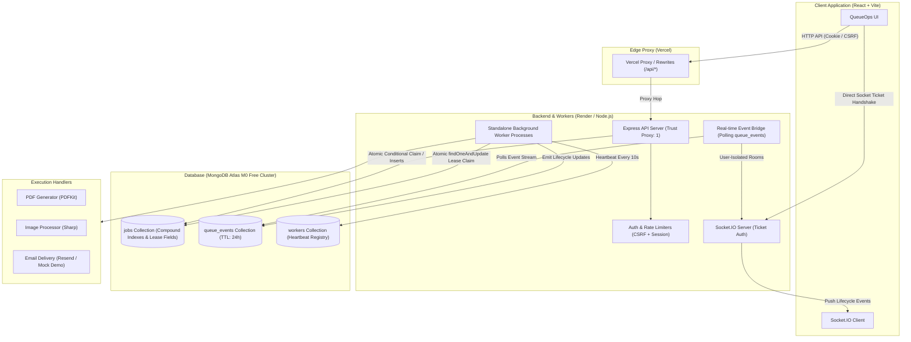
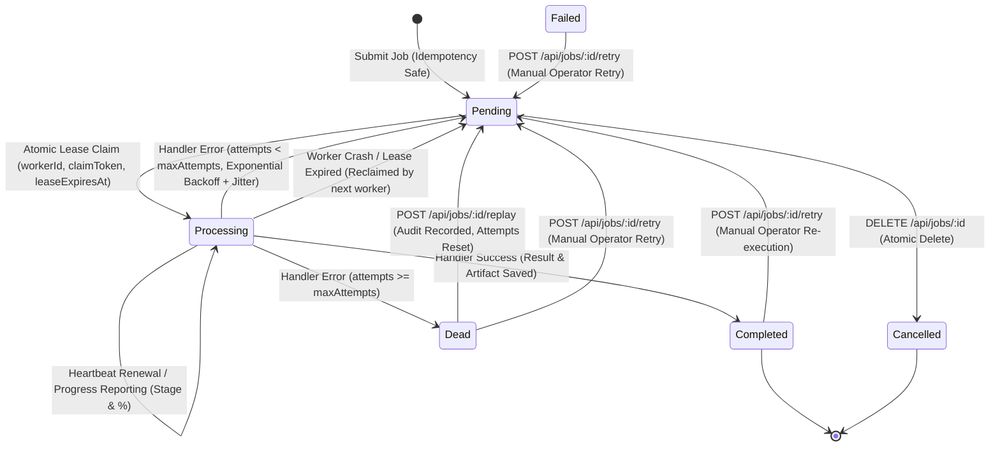

# QueueOps — Reliable Job Queue with Dead-Letter Recovery

QueueOps is a production-grade, multi-tenant asynchronous background job processing platform built with Node.js, Express, React, Vite, and MongoDB Atlas.

Queue mechanics are implemented from first principles using MongoDB atomic conditional operations, distributed worker leases, exponential backoff retries with jitter, dead-letter queue (DLQ) isolation, replay audit history, live progress reporting, and multi-stage execution handlers (PDF generation, Sharp image processing, and transactional email).

---

## Architecture Overview



---

## Job Lifecycle State Machine



---

## Core Technical Features

1. **Atomic Concurrency Boundary**:
   - Built on MongoDB's atomic `findOneAndUpdate` queries. Multiple concurrent workers can poll without duplicate execution or race conditions.
   - Leases use unique `claimToken` UUIDs: if a worker loses its lease (e.g. temporary CPU throttle or network partition), it cannot renew, complete, or fail the job after another worker has reclaimed it.
2. **Crash Recovery & Heartbeats**:
   - Active workers emit a heartbeat every 10 seconds (`WORKER_HEARTBEAT_INTERVAL_MS`).
   - Leases expire after 30 seconds (`WORKER_LEASE_DURATION_MS`). If a worker crashes abruptly without a graceful shutdown, another worker atomically reclaims the expired lease and continues processing.
3. **Dead Letter Queue & Replay**:
   - Jobs that exhaust their retry limit (`maxAttempts`) move to `dead` state with their full payload, error history, and `deadAt` timestamp.
   - Operators can replay dead jobs via `POST /api/jobs/:id/replay`, which resets attempts, schedules immediate or delayed execution, and records a capped audit history.
   - Manual retry via `POST /api/jobs/:id/retry` supports re-running failed, dead, or completed jobs.
4. **Real-time Event Bridge & Socket Ticket Auth**:
   - Multi-process communication between API and workers uses a MongoDB-backed `queue_events` collection with 24-hour TTL.
   - Socket.IO handshakes use short-lived single-use tickets (`GET /api/auth/socket-token`) with tenant isolation, preventing WebSocket proxy disconnects in cross-origin production topologies.
5. **Real Execution Handlers**:
   - **PDF Generation**: Renders multi-section executive reports using PDFKit and stores output in private tenant-isolated storage.
   - **Image Processing**: Resizes, optimizes, and generates thumbnails using Sharp with multi-stage progress reporting.
   - **Transactional Email**: Integrates with Resend and features an honest `EMAIL_DEMO_MODE` for safe local testing without external provider charges.
6. **High-Performance Aggregation Analytics**:
   - Single-query `$facet` pipeline returns 30-day queue overview, terminal success/failure rates, job type distribution, priority distribution, and daily activity trends.
7. **Free-Tier Optimized**:
   - Tailored specifically to run completely within free infrastructure tiers: **Vercel** (Edge static/proxy frontend), **Render** (Node.js API & background worker), and **MongoDB Atlas M0** (512MB shared cluster).

---

## Prerequisites

- Node.js and npm
- A MongoDB Atlas cluster (or another MongoDB deployment), or Docker for containerized evaluation

## Quick demo with Docker Compose

Before starting the stack, copy `.env.example` to a root-level `.env` and set
`MONGO_ROOT_USERNAME`, `MONGO_ROOT_PASSWORD`, and `AUTH_JWT_SECRET`. Use an
alphanumeric MongoDB username and a URL-safe base64url password so they can be
embedded in the internal MongoDB URI without escaping. Generate random values
locally with Node.js:

```powershell
node -e "console.log(require('node:crypto').randomBytes(32).toString('base64url'))"
node -e "console.log(require('node:crypto').randomBytes(48).toString('base64url'))"
```

Use the first output for the MongoDB password and the second for
`AUTH_JWT_SECRET`. The API refuses to start without a JWT secret of at least
32 bytes, and Compose refuses to start if any required setting is empty. Keep
the root `.env` private and untracked; never put real credentials in
`.env.example`.

The Compose stack initializes MongoDB root authentication, uses an
authenticated connection for both API and worker, and binds MongoDB, API, and
UI ports to `127.0.0.1`. It is a local development/demo setup, not a
production deployment. On an existing MongoDB data volume initialized without
authentication, setting these variables does not create a user retroactively;
back up the data and perform a deliberate local authentication migration rather
than deleting the volume.

Run the complete multi-process stack (MongoDB, API, Worker, and Nginx-served UI) with a shared private storage volume:

```bash
docker compose up --build
```

In another terminal, populate the demo account and sample jobs (PDF report, Sharp thumbnail, mocked email, and dead-letter queue recovery). Run the seed command inside the API container so it uses the authenticated `MONGODB_URI` configured by Compose, rather than a host `server/.env`:

```bash
docker compose exec api npm run demo:seed
```

The seeded account and jobs are demonstration data. Report figures and sample failure details are fictional/synthetic, not measured project metrics or production outcomes.

Open `http://localhost:5173` in your browser:
* **Email**: `demo@example.test`
* **Password**: `DemoPassword123!`

## Run locally without Docker

1. In MongoDB Atlas, create a cluster, create a database user, and add your current development IP address under **Network Access**.
2. In the cluster's **Connect** dialog, select **Drivers** and copy the Node.js connection string.
3. Copy `.env.example` to `server/.env`. Replace `<db_username>`, `<db_password>`, and `<cluster-host>` in `MONGODB_URI` with the database user's credentials and the host from Atlas. URL-encode special characters in the username or password. Replace the `AUTH_JWT_SECRET` placeholder with a random value of at least 32 bytes (for example, generate one locally with Node's `crypto.randomBytes(48)`). Keep both values only in `server/.env`; do not paste credentials into chat or commit that file.
4. In a terminal, start the API:

   ```powershell
   cd server
   npm install
   npm run dev
   ```

5. In a second terminal, start one worker:

   ```powershell
   cd server
   npm run worker
   ```

6. To start another worker, open another terminal in `server` and run `npm run worker` again. Each worker generates a unique ID by default. You can set `WORKER_ID` explicitly and adjust worker settings in `server/.env`.

7. In another terminal, run the client:

   ```powershell
   cd client
   npm install
   npm run dev
   ```

The client uses `/api` by default, which Vite proxies to `http://localhost:5000`; Vite also proxies the Socket.IO endpoint. To use another API base URL, copy `client/.env.example` to `client/.env.local` and set `VITE_API_BASE_URL` (for example `http://localhost:5000/api`). Only public API URLs belong in `VITE_` variables; never place backend credentials there.

8. Open the Vite URL shown in the client terminal. QueueOps shows analytics, worker status, job lists/details, job creation, and dead-letter replay. Socket.IO events trigger REST refetches; MongoDB and the REST API remain authoritative.

For standalone local development, run `npm run demo:seed` from the repository root after configuring `server/.env`. The host-side seed command reads `MONGODB_URI` from `server/.env`; it does not use the root Compose `.env`. Verify that it targets the intended development database, never production.

## Artifact cleanup

Cleanup is read-only by default. From the repository root, `npm run cleanup:artifacts` reports expired artifacts and old orphan files without deleting files or changing records. To delete in a development or test environment, run from `server` and explicitly confirm:

```powershell
cd server
$env:NODE_ENV = 'development'
$env:ARTIFACT_CLEANUP_TARGET_ID = 'reliable_job_queue_dev'
npm run cleanup:artifacts -- --confirm
```

Set `ARTIFACT_CLEANUP_TARGET_ID` in `server/.env` for repeat use; it must exactly match a database name containing a `dev`/`development` token when `NODE_ENV=development`, or a `test` token when `NODE_ENV=test`. The command displays the environment and candidate count before deletion. Confirmed cleanup is refused for production, unspecified environments, non-loopback MongoDB URIs, and mismatched target identities. The cleanup connection disables automatic index and collection creation, and dry-run performs reads only.

The loopback check validates the URI host, not the database server behind a local SSH tunnel or port forward. Do not use confirmed cleanup with a tunnel, proxy, or other forwarding setup; the target identity is an additional operator assertion, not proof of the server's physical location. Production deletion remains disabled.

The API reads `MONGODB_URI` from `server/.env` and only starts listening after a successful database connection. If the URI is missing or the connection fails, startup exits with a safe diagnostic that does not print the connection string.

Workers poll every 2000 ms by default when the queue is empty. Set `WORKER_POLL_INTERVAL_MS` in `server/.env` to change this. Set `WORKER_ID` only when you want a stable, unique ID for that worker; otherwise each process generates its own ID.

Failed handler executions increment `attempts` once. When the incremented count is below `maxAttempts`, the job returns to `pending` with a future `runAt`; otherwise it enters the `dead` state. The retry delay defaults to a 2000 ms base, is capped at 60000 ms, and adds up to 20% positive jitter without exceeding the cap. Configure `BASE_DELAY_MS`, `MAX_RETRY_DELAY_MS`, and `RETRY_JITTER_RATIO` in `server/.env`.

Each processing claim has a lease and a fresh `claimToken`. Workers renew the lease every 10000 ms by default; the default lease duration is 30000 ms. If a worker stops renewing and the lease expires, another worker can atomically reclaim the job. Reclaiming counts the abandoned execution once; if that reaches `maxAttempts`, the job becomes `dead`. Exhausted handler failures also enter `dead`. `attempts` counts failed or abandoned executions, while successful execution does not increment it. Configure `WORKER_LEASE_DURATION_MS` and `WORKER_HEARTBEAT_INTERVAL_MS`; the heartbeat interval must be shorter than the lease duration.

## Reliability verification and benchmark

MongoDB conditional updates are the concurrency boundary: only one worker can claim a pending job, and heartbeat/recovery/completion/failure operations must match the current owner, claim token, status, and lease. A lease-expired job may execute again; handler execution is therefore **at least once**, not exactly once. Job submission idempotency prevents duplicate job records, while provider idempotency and per-job output reuse reduce (but do not eliminate) duplicate external effects. Socket events remain best-effort; clients refresh from REST.

Run the backend integration tests against a local MongoDB only:

```powershell
cd server
$env:MONGODB_TEST_URI = "mongodb://127.0.0.1:27017/reliable_job_queue_test"
npm test
```

The test helper rejects non-loopback hosts and database names not ending `_test`, then uses and drops a process-specific isolated database. Never set this variable to Atlas or production.

For a reproducible local queue benchmark, use `npm run benchmark` from `server` with the same local-only `MONGODB_TEST_URI`. It submits jobs through the jobs REST router with 16 concurrent clients, then drains the batch using concurrent atomic claim/completion loops. Default volumes are 100 and 500 jobs and worker counts are 1 and 4; `BENCH_JOB_VOLUMES` (maximum 5000 per volume) and `BENCH_WORKER_COUNTS` (maximum 32) can override them. The benchmark excludes handler execution and provider/filesystem work; its throughput numbers describe this local API/queue/database path only.

One measured run is recorded in [DEVELOPMENT.md](./DEVELOPMENT.md). It is a small local baseline, not a production capacity estimate. Each result includes submission throughput, claim/completion throughput, request latency, and queue latency; queue latency includes the time spent submitting the batch before draining begins.

Dead jobs remain in the original jobs collection with their payload, type, attempts, final error, and `deadAt` timestamp. Use `GET /api/jobs/dead?page=1&limit=20` to inspect them, then `POST /api/jobs/:id/replay` to return a dead job to normal scheduling. Replay resets attempts and ownership, preserves the job's original creation `idempotencyKey`, and records a bounded replay history. A repeated create request with that key remains a conflict; replay does not create another job.

The unique per-owner `{ ownerId, idempotencyKey }` index prevents duplicate job records even when requests race; different users may reuse the same key. This is job-creation idempotency only: it does not guarantee that an external email/payment side effect runs exactly once. A handler and its downstream provider need their own idempotency mechanism for that guarantee.

Claim tokens prevent a previous claim from renewing, completing, or failing a job after another worker has reclaimed it. A handler's external side effect cannot always be cancelled if its lease is lost; the queue prevents the stale worker from persisting a result, but cannot undo an already-performed external action.

## Live updates, workers, and analytics

The API and worker processes share a MongoDB-backed queue-event collection. The API polls it and forwards safe lifecycle notifications through Socket.IO; event payloads contain job/worker identifiers and status metadata, never job payloads, errors, idempotency keys, or claim tokens. Events are best-effort notifications with 24-hour retention, not a durable client stream. On connect/reconnect the dashboard refetches REST data to recover missed updates. Configure `CLIENT_ORIGIN` as a comma-separated list of exact frontend origins if the defaults (`localhost` and `127.0.0.1`) do not fit your local setup.

## Authentication and tenant isolation

The app supports separate user accounts. Register at `/register` or sign in at `/login`. Passwords are bcrypt-hashed. A 30-minute JWT is stored only in an `HttpOnly`, `SameSite=Strict` cookie; browser storage is not used for session tokens. State-changing requests require a matching CSRF cookie/header and an allowed `Origin`. The API protects job, analytics, and worker routes, and scopes job data, idempotency keys, analytics, worker visibility, and socket events to the authenticated user. All accounts currently have the same capabilities; roles and password recovery are not implemented.

The worker processes are shared across accounts. A worker is shown only in the tenant associated with its current or most recently processed job; a worker that has never processed an owned job is not listed. Worker records do not represent dedicated per-user processes.

Jobs created before tenant support have no owner and are deliberately inaccessible through authenticated APIs and ineligible for worker claims. Do not assign an owner without verifying the record's intended account. Local-only migration scripts support the existing global idempotency index and explicit one-job-at-a-time legacy ownership assignment. They refuse non-loopback MongoDB hosts or database names not ending in `_dev` or `_test`:

```powershell
cd server
$env:MONGODB_URI = "mongodb://127.0.0.1:27017/reliable_job_queue_dev"
$env:ALLOW_TENANT_INDEX_MIGRATION = "1"
npm run migrate:tenant-indexes
```

For a verified legacy job, set `LEGACY_JOB_ID` and `LEGACY_OWNER_ID` to the intended MongoDB ObjectIds before running `npm run assign:legacy-job-owner`. Set `MONGODB_URI` to an explicitly local development database for these commands; it must end in `_dev` or `_test`. These utilities are intentionally restricted to local development/test databases; production/Atlas data migration requires a separately reviewed operational migration. Never point test or migration tooling at Atlas or production.

Workers register in MongoDB, update `lastSeenAt` on heartbeat, report the currently claimed job, and mark themselves stopped during graceful shutdown. A worker with a stale heartbeat is shown as unresponsive; abrupt crashes are not reported as clean shutdowns. Analytics aggregate job records created in the last 30 days. Success rate is completed / (completed + failed + dead); failure rate is (failed + dead) / the same terminal total. Average execution duration is the mean of `completedAt - claimedAt` for completed jobs with both timestamps. Counts are time-windowed current states, not historical state-transition totals. There are no historical trend charts.

## Backend and frontend tests

The repository provides automated testing for both backend and frontend layers:

1. **Frontend component and unit tests**:
   Fast native tests verifying React components (`StatusBadge`, `Pagination`, `Feedback`, `PageHeader`, `JobTable`), formatting utilities, and API client behavior:

   ```powershell
   npm run test:client
   ```

2. **Backend unit and safety tests**:
   Unit tests for retry logic, worker leases, handler dispatch, artifact cleanup safety, tenant quotas, and input validation without requiring a live MongoDB server:

   ```powershell
   npm run test:server
   ```

3. **Backend MongoDB integration tests**:
   To run the MongoDB concurrency, tenant isolation, and worker runtime integration tests, run a local MongoDB server and set an explicitly local test URI:

   ```powershell
   cd server
   $env:MONGODB_TEST_URI = "mongodb://127.0.0.1:27017/reliable_job_queue_test"
   npm test
   Remove-Item Env:MONGODB_TEST_URI
   ```

   The integration test fixture rejects non-local hosts and database names without a `_test` suffix. It creates a unique database for each test file process and drops only that generated database. Never set `MONGODB_TEST_URI` to Atlas or production.

4. **Continuous Integration**:
   Automated GitHub Actions CI (`.github/workflows/ci.yml`) runs backend tests against a MongoDB 7 service container, executes frontend component tests, verifies production client builds, validates Docker Compose configurations, and tests container builds.

## Current API

- `GET /api/health` — public API and database connection status.
- `POST /api/auth/register`, `POST /api/auth/login`, `GET /api/auth/me`, `POST /api/auth/logout` — account/session endpoints.
- `POST /api/jobs`, `GET /api/jobs`, `GET /api/jobs/:id`, `DELETE /api/jobs/:id` — authenticated, owner-scoped job operations.
- `GET /api/jobs/dead`, `POST /api/jobs/:id/replay` — inspect and replay dead jobs.
- `GET /api/analytics` — 30-day queue counts, terminal rates, and average execution duration.
- `GET /api/workers` — up to 100 recently seen worker records with active/idle/unresponsive/disconnected state.
- `POST /api/uploads/images` — upload a private JPEG, PNG, or WebP source image (authenticated and CSRF-protected).
- `GET /api/jobs/:jobId/artifacts/:artifactId` — download a completed job's private output (authenticated and owner-scoped).

Socket.IO event names include `job:created`, `job:claimed`, `job:completed`, `job:failed`, `job:retried`, `job:dead`, `job:replayed`, `job:cancelled`, `worker:updated`, and `worker:heartbeat`.

See [API_DOCUMENTATION.md](./API_DOCUMENTATION.md) for authentication and response details and [DEVELOPMENT.md](./DEVELOPMENT.md) for the day-by-day progress log.

## Real job handlers

The worker supports three real handlers:

- `send_email` submits a plain-text and/or HTML message to Resend. Set `RESEND_API_KEY` and `EMAIL_FROM` only in `server/.env`. The sender address/domain must be permitted by your Resend account. A successful response means Resend **accepted** the request, not that the recipient received it. The API key is never sent to the frontend or written to job results/logs.
- `generate_pdf` renders a titled report with sections, paragraphs, and an ISO-8601 generation timestamp to an actual PDF.
- `process_image` accepts an uploaded JPEG, PNG, or WebP and can resize, convert, or create a 256×256 WebP thumbnail. Remote URLs and filesystem paths are not accepted.

Email sending is disabled by default, even if Resend credentials are present. To opt in for a controlled shared-provider setup, create a Resend account and API key, verify/configure the sender domain, then add `RESEND_API_KEY`, `EMAIL_FROM`, `EMAIL_SENDING_ENABLED=true`, and a non-empty `EMAIL_ALLOWED_RECIPIENTS` allowlist to `server/.env`. The allowlist accepts exact email addresses and exact domains prefixed with `@`; wildcard/subdomain matching is not supported. Configure `EMAIL_DAILY_QUOTA_PER_USER` (default 5), `EMAIL_DAILY_QUOTA_GLOBAL` (default 100), and `EMAIL_JOBS_PER_MINUTE` (default 3) for provider spend/abuse limits. Atomic MongoDB limits are enforced both when a user queues/replays an email and immediately before a worker contacts the provider. Submission and send counters are separate, so staging jobs over several days cannot bypass actual send limits; send attempts count conservatively even if provider acceptance is uncertain. Per-minute limits are also checked separately at submission and execution. Restart the worker after changing environment variables. Never put the provider key in client configuration or `VITE_` variables. Tests mock the provider and do not send email.

PDFs and transformed images are written to `server/storage/` by default, or to the server-side `JOB_STORAGE_DIR` location. If the API and worker run as separate processes/hosts, configure them to use the same private shared directory. They are not stored in MongoDB or served as public static files. An authenticated download route checks the session owner, completed job, persisted result and output asset association before reading. Do not expose this directory through a web server or shared public drive. Back up or clean up the private storage directory according to your local retention needs.

Image uploads are limited to 5 MB, 4000×4000 pixels, and JPEG/PNG/WebP; generated artifacts are limited to 10 MB. PDF reports accept 1–20 sections and at most 80,000 total text characters. Example payloads and endpoint contracts are in [API_DOCUMENTATION.md](./API_DOCUMENTATION.md).

Output records are unique per job and are reused on retries/replays to reduce duplicate file generation. Processed images are previewed inline through the same authenticated, owner-checked artifact route; PDFs remain attachment downloads. Email requests reuse a job/replay-scoped Resend idempotency key across queue retries where the provider honors it. External side effects are not exactly-once: a worker can lose its lease after a provider accepts an email but before the queue persists completion, and provider idempotency is subject to provider support/retention. Job `result` stores only safe metadata; it never includes file bytes, server paths, email content, or credentials.
